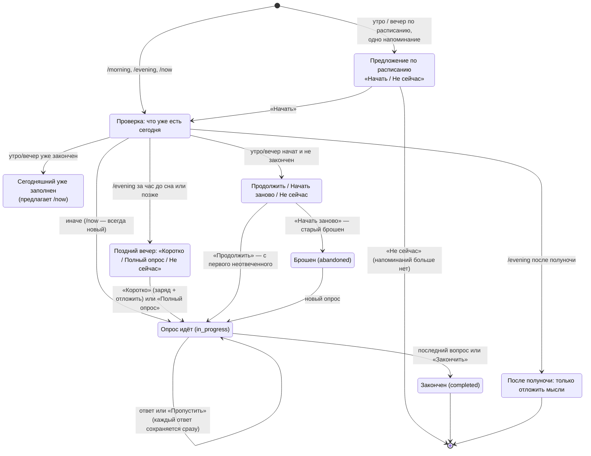
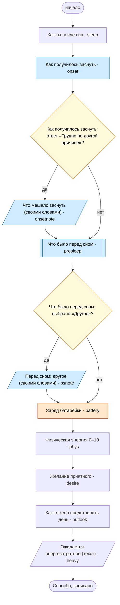
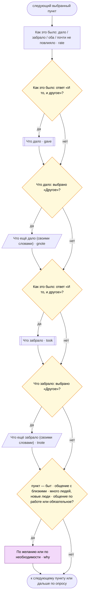
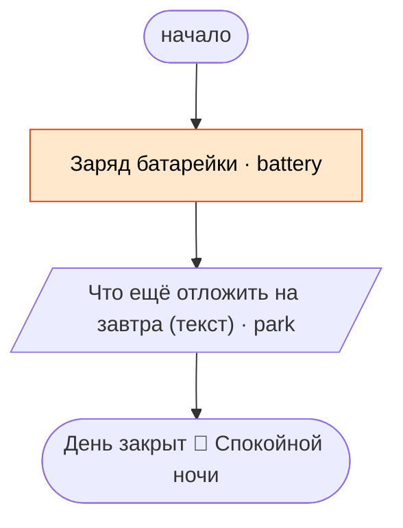
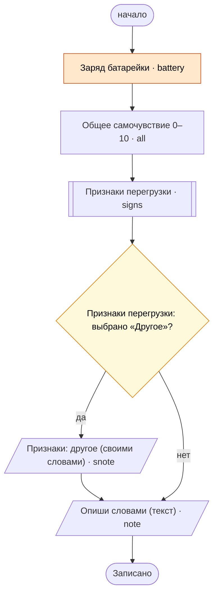
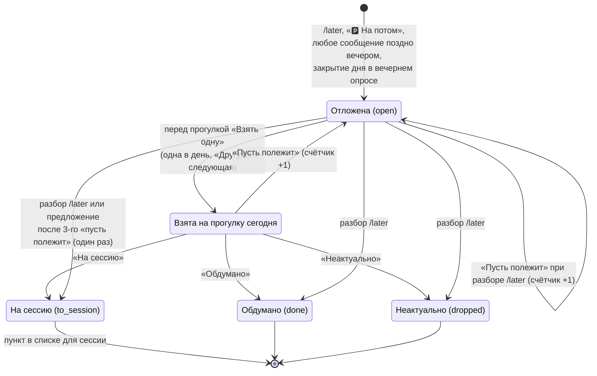

# Как идут опросы

_Этот файл собирается из кода: `.venv/bin/python -m recovery.flowdocs > docs/FLOWS.md`. Тест `tests/test_flow_docs.py` следит, чтобы он не устарел._

Как читать диаграммы:

- Каждый вопрос можно **пропустить** — опрос просто идёт дальше. «**Закончить**»
  завершает опрос на любом вопросе. Каждый ответ сохраняется сразу.
- Форма: прямоугольник — один вариант или шкала; `[[двойная рамка]]` —
  можно выбрать несколько; параллелограмм — свободный текст.
- Жёлтый ромб — условие: вопрос задаётся, только если ответ «да».
- Цвет вопроса — от чего он зависит в настройках:
  оранжевый — 🔋 батарейка; фиолетовый — 🧩 вопросы для гипотез;
  голубой — 🧩 как получилось заснуть; зелёный — 🐕 время прогулки задано.
  Выключенное просто не задаётся.
- Подпись после «·» — id вопроса в `conversation/flows.py`.
- Текст, написанный во время вопроса с кнопками, сохраняется как заметка к опросу.
  Сообщение, похожее на кризисное, останавливает опрос (его можно продолжить потом).

Наборы дополнительных вопросов (`/settings → 🧩`):

- **Вопросы для проверки гипотез** — вечером: сколько было обязательств, что занимает мысли, по желанию или по необходимости было общение и быт, давление на себя (через вечер)
- **Как получилось заснуть** — утром: засыпание и что было перед сном

## Как начинается опрос

## Утро (`/morning`)

## Вечер (`/evening`)

```mermaid
flowchart TD
  start([начало])
  q_cmp["По сравнению с утром · cmp"]
  start --> q_cmp
  q_battery["Заряд батарейки · battery"]
  q_cmp --> q_battery
  q_oblig["Сколько обязательств · oblig"]
  q_battery --> q_oblig
  q_ep[["Что было заметного (эпизоды) · ep"]]
  q_oblig --> q_ep
  d_epnote{"Что было заметного (эпизоды): выбрано «Другое»?"}
  q_ep --> d_epnote
  d_epnote -->|да| q_epnote[/"Эпизод «другое» (своими словами) · epnote"/]
  g_ep[["для каждого выбранного пункта, по порядку, не больше 3: вопросы ниже · rate, gave, gnote, took, tnote, why"]]
  q_epnote --> g_ep
  d_epnote -->|нет| g_ep
  q_preocc["Что занимает мысли · preocc"]
  g_ep --> q_preocc
  d_pnote{"Что занимает мысли: ответ «Немного» / «Да, сильно»?"}
  q_preocc --> d_pnote
  d_pnote -->|да| q_pnote[/"Что именно занимает (текст, можно 📌 на сессию) · pnote"/]
  q_energy["Силы на приятное · energy"]
  q_pnote --> q_energy
  d_pnote -->|нет| q_energy
  d_press{"через день (по чётным датам)?"}
  q_energy --> d_press
  d_press -->|да| q_press[["Давление на себя · press"]]
  d_pressnote{"Давление на себя: выбрано «Другое»?"}
  q_press --> d_pressnote
  d_press -->|нет| d_pressnote
  d_pressnote -->|да| q_pressnote[/"Давление: другое (своими словами) · pressnote"/]
  q_more["Подробнее? · more"]
  q_pressnote --> q_more
  d_pressnote -->|нет| q_more
  q_phys["Физическая энергия 0–10 · phys"]
  q_more -->|да| q_phys
  q_emo["Эмоциональный ресурс 0–10 · emo"]
  q_phys --> q_emo
  q_soc["Социальный ресурс 0–10 · soc"]
  q_emo --> q_soc
  q_cog["Когнитивный ресурс 0–10 · cog"]
  q_soc --> q_cog
  q_all["Общее самочувствие 0–10 · all"]
  q_cog --> q_all
  q_interest["Интерес к делам 0–5 · interest"]
  q_all --> q_interest
  q_signs[["Признаки перегрузки · signs"]]
  q_interest --> q_signs
  d_snote{"Признаки перегрузки: выбрано «Другое»?"}
  q_signs --> d_snote
  d_snote -->|да| q_snote[/"Признаки: другое (своими словами) · snote"/]
  q_tmrw[/"Учесть завтра (текст) · tmrw"/]
  q_snote --> q_tmrw
  d_snote -->|нет| q_tmrw
  q_more -->|нет / пропуск| q_tmrw
  d_walk{"сегодня брала мысль на прогулку?"}
  q_tmrw --> d_walk
  d_walk -->|да| q_walk["Мысль с прогулки: что с ней · walk"]
  q_park[/"Что ещё отложить на завтра (текст) · park"/]
  q_walk --> q_park
  d_walk -->|нет| q_park
  done(["День закрыт 🌙"])
  q_park --> done
  classDef battery fill:#ffe8cc,stroke:#d9480f,color:#000
  classDef hyp fill:#f3d9fa,stroke:#862e9c,color:#000
  classDef sleep fill:#d0ebff,stroke:#1864ab,color:#000
  classDef walk fill:#d3f9d8,stroke:#2b8a3e,color:#000
  classDef cond fill:#fff9db,stroke:#e67700,color:#000
  class q_battery battery
  class q_oblig,q_preocc,q_pnote,q_press,q_pressnote hyp
  class d_epnote,d_pnote,d_press,d_pressnote,d_snote,d_walk cond
  class q_walk walk
```

### Вечер: вопросы по каждому выбранному эпизоду

Задаются по очереди для первых трёх выбранных эпизодов («Ничего особенного» — не эпизод).

## Поздний вечер: короткий вариант

Когда `/evening` за час до сна или позже и выбрано «Коротко».

## Отметить состояние сейчас (`/now`)

## Отложенные мысли

## Расписание дня

| Время (пример) | Что делает бот | Откуда |
|---|---|---|
| утренний опрос, 09:30 | предложение утреннего опроса; напоминание через 2 ч, если не начат | `/settings` |
| вечерняя прогулка, 18:45 | только если что-то отложено: «взять одну мысль или просто погулять» | `/settings → 🐕` |
| вечерний опрос, 20:45 | предложение вечернего опроса; напоминание через 45 мин | `/settings` |
| за час до сна, 22:00 → +8 ч | поздний режим: без напоминаний, текст уходит «на потом», `/evening` — коротко | `/settings → 🌙` |
| за N часов до сессии | сводка к сессии | `/settings → Сессия` |
